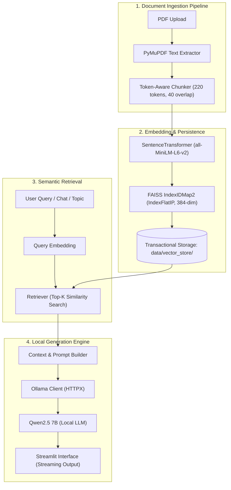

# StudyAstra — AI-Powered Python Study Assistant

StudyAstra is a local-first, AI-powered study companion and academic knowledge assistant built with Python and Streamlit. It allows students and researchers to ingest PDF textbooks and lecture slides, extract structured text, generate local vector embeddings, perform semantic similarity retrieval, and interact with their study materials through multi-turn conversational chat, automated summaries, practice questions, interactive quizzes, academic study notes, and flashcards.

The system is designed with a **privacy-first, offline-capable architecture**: all vector embeddings and search indexes run locally on the user's computer via Sentence Transformers and FAISS, while language generation is powered by a local **Ollama** instance running **Qwen2.5 7B**. Zero cloud API keys or external subscription services are required.

---

## 1. Features

StudyAstra provides a unified study interface organized into eight dedicated modules:

- **PDF Ingestion & Text Extraction:** Page-by-page text extraction from uploaded PDF documents using PyMuPDF (`pymupdf`) with layout-aware column sorting, boundary preservation, and SHA-256 deduplication.
- **Conversational PDF Chatbot (RAG):** Multi-turn conversational study assistant grounded strictly in document context, featuring sliding-window conversation memory, conversational query rewriting, and verifiable source citations with page attribution.
- **PDF Summarization:** Single-PDF summarization across Full Document, Page Range, Section, or Topic with prompt-aware hierarchical map-reduce and configurable length (Short, Medium, Detailed).
- **Practice Question Generation:** Generates grounded practice questions across four types: Multiple Choice (MCQ), Short Answer, True/False, and Mixed distributions, with Easy, Medium, and Hard difficulty levels.
- **Interactive Quiz & Evaluation Engine:** Interactive testing environment with hidden answers during attempts, deterministic grading for MCQ/TF, batched semantic grading for short answers, and detailed review of missed pages.
- **Academic Study Notes:** Generates structured, high-yield study notes with executive summaries, core technical definitions, mechanisms, and key exam takeaways.
- **Flashcard Deck Generator & Flip Viewer:** Interactive flippable study flashcards with Anki CSV and Markdown export options.
- **Vector Retrieval Testing:** Direct semantic similarity inspection tool that queries the FAISS vector index across all documents or filtered to a single PDF without calling any LLM.
- **Study Timers & Challenges:** Built-in Pomodoro study timer, countdown challenge timers, and timed quiz sessions to support disciplined study habits.

---

## 2. Technology Stack

| Technology | Role in StudyAstra |
| :--- | :--- |
| **Python** (3.11+ / 3.14) | Core programming language for application logic, pipeline, and tests |
| **Streamlit** (v1.42+) | Reactive web user interface, session state management, and token streaming |
| **Ollama** | Local LLM inference server managing the Qwen2.5 7B model |
| **Qwen2.5 7B** (`qwen2.5:7b`) | Primary local language model for grounded chat, summaries, notes, and quizzes |
| **Sentence Transformers** | Local dense semantic embedding generation using `all-MiniLM-L6-v2` |
| **FAISS** (`faiss-cpu`) | High-performance vector index (`IndexIDMap2` wrapping `IndexFlatIP`) |
| **PyMuPDF** (`pymupdf`) | Fast, in-memory PDF text extraction and layout sorting |
| **PyTorch** (`torch` CPU) | Tensor computation backend for local embedding generation |
| **HTTPX** | Resilient asynchronous and synchronous HTTP client for Ollama communication |

---

## 3. Architecture Overview

StudyAstra decouples document ingestion, embedding generation, and vector retrieval from the language model backend.



### Core Architecture Principles
1. **Strict Context Adherence:** Generation prompts instruct the model to answer exclusively from the retrieved document context. When information is missing, the model explicitly declines rather than hallucinating.
2. **Deterministic Source Attribution:** Source chunk IDs and page numbers are derived deterministically from the FAISS metadata store—never from LLM guesses.
3. **Transactional Storage:** Vector store mutations use generation-based transactional manifests (`manifest.json`) with safe atomic replacement, preventing index corruption.
4. **Single-Instance Safety:** An OS-level kernel byte lock (`.app.lock`) ensures only one StudyAstra process accesses the vector database at a time.

---

## 4. Prerequisites

Before installing StudyAstra, ensure your system meets the following requirements:

- **Operating System:** Windows 10/11 (64-bit), macOS, or Linux.
- **Python Version:** Python 3.11, 3.12, 3.13, or 3.14 (64-bit strictly required for PyTorch and FAISS).
- **RAM:** Minimum 8 GB (16 GB recommended for running Ollama Qwen2.5 7B alongside Streamlit).
- **GPU (Optional):** NVIDIA GPU with 6+ GB VRAM for accelerated LLM inference; CPU inference is also supported via Ollama layer offloading.
- **Ollama:** Installed and running locally.

---

## 5. Installation and Setup

### 1. Clone the Repository
```bash
git clone https://github.com/Amanuniyal47/studyastra.git
cd studyastra
```

### 2. Create and Activate a Virtual Environment

**On Windows (PowerShell):**
```powershell
python -m venv venv
.\venv\Scripts\activate
```

**On Linux / macOS:**
```bash
python3 -m venv venv
source venv/bin/activate
```

### 3. Install Dependencies

For Windows CPU installations, install the CPU-optimized PyTorch wheel first, then install the remaining requirements:

```powershell
# Step A: Install PyTorch CPU wheel
pip install torch --index-url https://download.pytorch.org/whl/cpu

# Step B: Install project dependencies
pip install -r requirements.txt
```

*(On Linux / macOS or systems with CUDA, running `pip install -r requirements.txt` directly will install PyTorch from PyPI).*

---

## 6. Local Ollama & Model Setup

StudyAstra uses Ollama to manage and serve the local **Qwen2.5 7B** language model.

### 1. Install Ollama
Download and install Ollama from [ollama.com/download](https://ollama.com/download).

### 2. Start the Ollama Service
Ensure Ollama is running in the background:
```bash
ollama serve
```

### 3. Download the Qwen2.5 7B Model
Download the required model weights (approximately 4.7 GB):
```bash
ollama pull qwen2.5:7b
```

### 4. Verify Model Availability
```bash
ollama list
```
Confirm that `qwen2.5:7b` appears in the list of installed models.

---

## 7. Configuration

Copy the example environment file to create your local `.env`:

**On Windows (PowerShell):**
```powershell
Copy-Item .env.example .env
```

**On Linux / macOS:**
```bash
cp .env.example .env
```

The default `.env.example` is pre-configured for local Ollama execution:

```ini
# LLM Provider Configuration
LLM_PROVIDER=ollama

# Ollama Local LLM Configuration (Qwen2.5 7B)
OLLAMA_BASE_URL=http://localhost:11434
OLLAMA_MODEL=qwen2.5:7b
OLLAMA_TEMPERATURE=0.2
OLLAMA_MAX_TOKENS=2048
OLLAMA_CONTEXT_WINDOW=4096
OLLAMA_TIMEOUT_SECONDS=60.0
OLLAMA_KEEP_ALIVE=5m

# Local Embeddings & Vector Store
EMBEDDING_MODEL=all-MiniLM-L6-v2
TOP_K=3
SUMMARY_MAX_BATCH_TOKENS=2400
QUESTION_MAX_BATCH_TOKENS=2400
NOTES_MAX_BATCH_TOKENS=2400
FLASHCARD_MAX_BATCH_TOKENS=2400
```

> [!NOTE]
> `GROQ_API_KEY` is completely optional. If left blank, StudyAstra operates in 100% offline local mode using Ollama.

---

## 8. Running the Application

### Preflight Diagnostics (Recommended)
Before launching the app, run the built-in diagnostic script to verify system compatibility:
```bash
python scripts/check_env.py
```

### Launch the Streamlit App
Start the web interface:
```bash
streamlit run app.py
```

The application will launch in your default web browser at:
**[http://localhost:8501](http://localhost:8501)**

---

## 9. Running the Test Suite

StudyAstra includes an automated unit and integration test suite covering vector indexing, transactional rollback, question generation schemas, quiz evaluation, conversation memory, and application lifecycle locks.

Run the test suite from the repository root:
```bash
python -m unittest discover -s tests -p "test_*.py"
```

### Verified Test Results
- **Total Tests:** 479
- **Passed:** 478
- **Skipped:** 1 (`tests.test_embeddings.TestRealEmbeddingModelSmoke` — opt-in live model download test)
- **Failures / Errors:** 0

All 478 tests run completely offline without requiring GPU hardware, external network access, or an active Ollama instance.

---

## 10. Project Directory Structure

```text
studyastra/
├── app.py                              # Streamlit entry point & unified UI tabs
├── requirements.txt                    # Verified runtime dependency manifest
├── requirements-windows-prod.txt       # Production-pinned Windows manifest
├── .env.example                        # Safe configuration template
├── .gitignore                          # Excludes local data, keys, models & locks
├── README.md                           # Project documentation
├── scripts/
│   ├── check_env.py                    # Preflight environment diagnostics
│   └── prepare_model.py                # Embedding model cache preloader
├── src/
│   ├── config.py                       # Centralized configuration & validators
│   ├── chat/                           # Multi-turn conversational RAG subsystem
│   │   ├── conversation_memory.py      # Sliding-window memory & thread managers
│   │   ├── chat_orchestrator.py        # Centralized turn execution & retrieval
│   │   ├── chat_prompts.py             # Prompt engineering & strict refusal rules
│   │   └── query_rewriter.py           # Ambiguous follow-up query rewrite engine
│   ├── ingestion/
│   │   ├── pdf_loader.py               # PyMuPDF text extractor & layout sorting
│   │   └── chunker.py                  # Token-aware sentence/paragraph chunker
│   ├── retrieval/
│   │   ├── embeddings.py               # Local SentenceTransformer service
│   │   ├── vector_store.py             # Transactional FAISS storage & generations
│   │   └── retriever.py                # Top-K semantic similarity search
│   ├── generation/
│   │   ├── llm_provider.py             # Ollama & base provider abstractions
│   │   ├── answer_generator.py         # Grounded single-turn Q&A engine
│   │   ├── summarizer.py               # Hierarchical map-reduce summarizer
│   │   ├── question_generator.py       # Practice question batch generator
│   │   ├── quiz_evaluator.py           # MCQ, TF & short-answer quiz evaluator
│   │   ├── study_notes_generator.py    # Academic structured notes generator
│   │   ├── flashcard_generator.py      # Schema-validated flashcard generator
│   │   └── explanation_generator.py    # Multi-level concept explainer
│   └── utils/
│       ├── app_lock.py                 # Single-instance OS byte-range locker
│       ├── timer_manager.py            # Pomodoro & study challenge timers
│       ├── study_statistics.py         # Local quiz and study performance stats
│       └── file_utils.py               # SHA-256 document hashing & helpers
└── tests/                              # Comprehensive offline unit test suite (479 tests)
```

---

## 11. Known Limitations

- **Image-Only & Scanned PDFs:** Text extraction relies on embedded text streams via PyMuPDF. Scanned document images without an embedded OCR text layer will return an empty text notice.
- **Hardware-Dependent Inference:** Generation latency depends on local hardware. On an NVIDIA RTX 4050 (6 GB VRAM) or equivalent, token streaming is near real-time (~30-50 tokens/sec); on CPU-only machines, generation takes longer depending on CPU core count.
- **First-Run Embedding Model Download:** On the very first run, Sentence Transformers downloads the `all-MiniLM-L6-v2` model weights (~90 MB) into the local user cache (`~/.cache/huggingface/hub/`). Subsequent runs are completely offline.

---

## 12. Academic Project Notice

StudyAstra was developed as a personal academic software engineering project to explore offline-capable Retrieval-Augmented Generation (RAG), local LLM orchestration, and computer-assisted study workflows.

---

## 13. License

This repository does not currently include an open-source software license. All rights are reserved by the author. A formal open-source license may be added in a future release.
