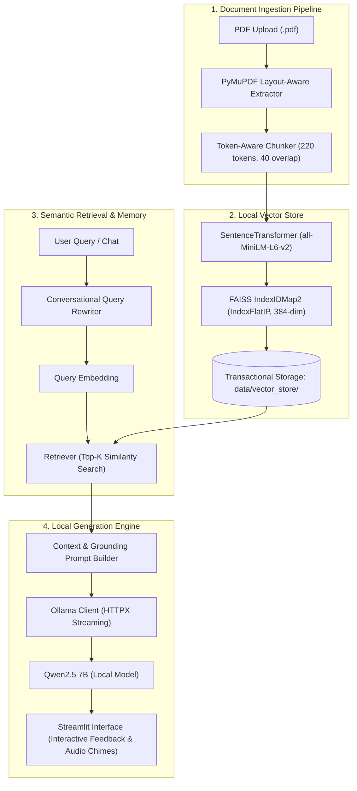

# StudyAstra — AI-Powered Academic Study Companion

StudyAstra is a local-first, privacy-focused academic study assistant and document intelligence platform built with Python and Streamlit. Designed for students, researchers, and self-directed learners, StudyAstra transforms PDF course materials—including textbooks, lecture slides, and syllabus documents—into an interactive, offline study environment powered by local language models and dense vector search.

The system integrates conversational Retrieval-Augmented Generation (RAG), hierarchical map-reduce summarization, automated practice questions, interactive quizzes, academic study notes, flashcards with Anki export, and study timers featuring synthesized acoustic chimes.

---

## 1. Problem Statement & Motivation

Traditional digital study workflows present several acute challenges:

1. **High Cognitive Overhead:** Textbooks and academic syllabi often span hundreds of pages. Manually locating definitions, tracing interconnected concepts, and extracting key exam takeaways consumes disproportionate study time.
2. **Privacy Risks of Cloud AI:** Uploading unpublished research, proprietary course materials, or personal lecture notes to public commercial AI clouds exposes sensitive academic data to third-party retention and model training.
3. **Internet Dependency & Distractions:** Cloud-reliant study tools fail in offline environments (libraries, transit, remote campuses) and expose students to browser-based distractions.
4. **Passive Reading vs. Active Recall:** Simply reading PDF documents is among the least effective retention strategies. Students benefit significantly from immediate self-testing, practice questions, and structured focus intervals.

**StudyAstra solves this by running 100% locally on your personal computer.** Vector indexing runs locally via FAISS and Sentence Transformers, and generative intelligence is powered by **Qwen2.5 7B** running on your local machine via **Ollama**. Zero cloud subscriptions or API keys are required.

---

## 2. Core Features

StudyAstra provides a unified academic interface organized into seven student-facing modules:

- **Conversational PDF Chat (RAG):** Multi-turn study dialogue strictly grounded in your active PDF document. Features sliding-window conversation memory, multi-thread management, conversational query rewriting, and verifiable page-level source citations.
- **Hierarchical PDF Summarization:** Generates high-fidelity summaries across four scopes: Full Document, Specific Page Range, Chapter Section, or Custom Topic. Employs a token-budgeted map-reduce algorithm with configurable summary depth (Short, Medium, Detailed).
- **Academic Study Notes:** Automatically synthesizes comprehensive, high-yield study notes formatted with executive overviews, core technical definitions, operational mechanisms, and key exam takeaways. Exportable directly to Markdown.
- **Practice Question Generation:** Generates grounded practice questions across four formats: Multiple Choice (MCQ), Short Answer, True/False, and Mixed distributions, across Easy, Medium, and Hard difficulty tiers.
- **Interactive Quiz & Evaluation Engine:** Stateful testing interface that hides answers during attempts, tracks timing, evaluates multiple-choice questions deterministically, evaluates short answers through batched semantic grading, and provides detailed feedback on missed concepts.
- **Active Recall Flashcards:** Interactive flip-card study interface with Anki-compatible CSV export and Markdown deck downloads.
- **Study Timers & Challenges:** Built-in Pomodoro focus timer and countdown study challenge sprint tracker, featuring synthesized Web Audio acoustic completion chimes and persistent study streak tracking.
- **Quick Q&A:** Fast single-turn question-answering mode for quick factual queries grounded directly in document chunks.

*(Note: An internal Vector Retrieval Testing tab is available for developers and instructors via `?dev=true` or in test environments).*

---

## 3. Technology Stack

| Component | Technology | Version | Purpose |
| :--- | :--- | :--- | :--- |
| **Language** | Python | 3.11 – 3.14 (64-bit) | Application logic, retrieval pipeline, and test harness |
| **UI Framework** | Streamlit | `>=1.42.0` | Reactive web interface, session state, and token streaming |
| **Local LLM Server** | Ollama | Latest | Local model execution and HTTP inference endpoint |
| **Language Model** | Qwen2.5 7B | `qwen2.5:7b` | Primary local LLM for chat, notes, summaries, and quizzes |
| **Embeddings** | Sentence Transformers | `>=3.4.0` | Dense semantic embeddings (`all-MiniLM-L6-v2`, 384 dimensions) |
| **Vector Storage** | FAISS CPU | `>=1.9.0` | High-performance vector similarity search (`IndexIDMap2` + `IndexFlatIP`) |
| **PDF Extraction** | PyMuPDF | `>=1.25.0` | Fast text extraction, boundary preservation, and layout sorting |
| **Tensor Backend** | PyTorch (CPU) | `>=2.2.0` | Local tensor calculations for embedding generation |
| **HTTP Client** | HTTPX | `>=0.27.0` | High-performance client for Ollama streaming and non-blocking health checks |

---

## 4. System Architecture

StudyAstra decouples document ingestion, embedding generation, and vector retrieval from the generative language model backend:



### Key Architectural Safeguards
1. **Strict Context Adherence:** Prompts enforce that the model answers exclusively using retrieved document evidence. If information is absent, the model explicitly declines rather than hallucinating.
2. **Deterministic Source Attribution:** Source chunk IDs, filenames, and page numbers are derived deterministically from FAISS metadata, ensuring verifiable citations.
3. **Transactional Storage & Rollback:** Vector store modifications use generation-based transactional manifests (`manifest.json`) with atomic file replacements, protecting against index corruption during power outages or process termination.
4. **Single-Instance Application Lock:** An OS-level kernel byte-range lock (`.app.lock`) prevents multiple StudyAstra processes from concurrently accessing the vector index.

---

## 5. RAG Pipeline & Document Processing

### Layout-Aware PDF Ingestion
- Uploaded PDFs are parsed page-by-page using PyMuPDF (`fitz`).
- Column-aware spatial sorting preserves reading order across multi-column textbooks and research papers.
- SHA-256 content hashes prevent duplicate document indexing.

### Chunking & Dense Embeddings
- Text streams are partitioned into chunks of **220 tokens** with a **40-token overlap** to maintain semantic continuity across chunk boundaries.
- Chunks preserve paragraph and sentence boundaries.
- Each chunk is embedded into a **384-dimensional dense vector** using `sentence-transformers/all-MiniLM-L6-v2`.
- Embeddings are L2-normalized so that inner product (`IndexFlatIP`) calculates exact cosine similarity.

### Conversational Memory & Query Rewriting
- Chat sessions maintain multi-turn context using sliding-window token memory.
- Pronouns and ambiguous follow-ups (e.g., *"What were its main causes?"*) are rewritten into self-contained retrieval queries before querying FAISS, ensuring high-accuracy semantic retrieval throughout multi-turn dialogues.

---

## 6. Academic UI/UX Design System

Stage 12 and 12.1 introduce a custom academic design system tailored for focus and readability:

- **Academic Color Palette:**
  - Background: Warm Ivory (`#F7F8F6`)
  - Surfaces & Cards: Crisp White (`#FFFFFF`) with hairline borders (`#E5E9E6`)
  - Typography: Charcoal (`#202A33`) and Muted Slate (`#68737D`)
  - Accents: Deep Forest Green (`#315C50`, hover `#25493F`) and Soft Sage (`#DCE9E3`)
- **Anti-Clipping Typography:** Balanced heading hierarchy preventing clipped titles across viewports.
- **Compact Sidebar:** Bounded desktop width (`290px–320px`) with uppercase micro-headers and active thread highlighting.
- **Dashed Upload Dropzone:** Minimal dashed dropzone with hover transitions and clear format guidance (PDF, up to 50MB).
- **Assistant Typing Indicator:** Three small forest-green pulsing dots (`#315C50`) displayed while waiting for local tokens, transitioning smoothly into token streaming.
- **Web Audio API Timer Notifications:** Synthesizes client-side acoustic completion chimes with zero external audio dependencies:
  - Focus & Challenge completion: Pure 528 Hz bell chime with smooth exponential decay.
  - Break completion: Ascending two-tone chime (440 Hz → 587 Hz).
  - Configurable sound toggle (`pomo_sound_enabled`) in timer settings.

---

## 7. Prerequisites & System Requirements

- **Operating System:** Windows 10/11 (64-bit), macOS (Apple Silicon or Intel), or Linux (Ubuntu 20.04+).
- **Python:** Python 3.11, 3.12, 3.13, or 3.14 (64-bit strictly required).
- **Memory (RAM):** 8 GB minimum; 16 GB recommended for smooth local LLM inference alongside Streamlit.
- **Storage:** ~6 GB free disk space (for Qwen2.5 7B model weights and embedding caches).
- **GPU (Optional):** NVIDIA GPU with 6+ GB VRAM provides accelerated token generation; CPU inference is fully supported via Ollama layer offloading.
- **Ollama:** Installed and running locally.

---

## 8. Installation & Setup

### Step 1: Clone the Repository
```bash
git clone https://github.com/Amanuniyal47/studyastra.git
cd studyastra
```

### Step 2: Create and Activate a Virtual Environment

**On Windows (PowerShell):**
```powershell
python -m venv venv
.\venv\Scripts\activate
```

**On Linux / macOS:**
```bash
python3 -m venv venv
source venv/bin/activate
```

### Step 3: Install Dependencies

For Windows CPU installations, install the CPU-optimized PyTorch wheel first, then install the remaining requirements:

```powershell
# Step A: Install PyTorch CPU wheel
pip install torch --index-url https://download.pytorch.org/whl/cpu

# Step B: Install dependencies
pip install -r requirements.txt
```

*(On Linux / macOS or machines with CUDA, running `pip install -r requirements.txt` directly installs compatible PyTorch packages).*

### Step 4: Install and Start Ollama

1. Download Ollama from [ollama.com/download](https://ollama.com/download).
2. Start the Ollama background daemon:
   ```bash
   ollama serve
   ```
3. In a separate terminal, download the Qwen2.5 7B model (~4.7 GB):
   ```bash
   ollama pull qwen2.5:7b
   ```
4. Verify the model is installed:
   ```bash
   ollama list
   ```

### Step 5: Configure Environment Variables

Create your local `.env` file from the provided template:

**On Windows (PowerShell):**
```powershell
Copy-Item .env.example .env
```

**On Linux / macOS:**
```bash
cp .env.example .env
```

The pre-configured defaults are optimized for local Ollama execution:
```ini
LLM_PROVIDER=ollama
OLLAMA_BASE_URL=http://localhost:11434
OLLAMA_MODEL=qwen2.5:7b
OLLAMA_TEMPERATURE=0.2
OLLAMA_MAX_TOKENS=2048
OLLAMA_CONTEXT_WINDOW=4096
EMBEDDING_MODEL=all-MiniLM-L6-v2
TOP_K=3
```

---

## 9. Running the Application

### 1. Run Preflight Diagnostics (Recommended)
Verify that your Python environment, Ollama connection, and configuration are healthy:
```bash
python scripts/check_env.py
```

### 2. Pre-cache Embedding Model (Optional for completely offline use)
To pre-download the embedding model before going offline:
```bash
python scripts/prepare_model.py
```

### 3. Launch StudyAstra
```bash
streamlit run app.py
```

Open your browser to: **[http://localhost:8501](http://localhost:8501)**

---

## 10. Automated Test Suite

StudyAstra includes an automated unit and integration test suite covering document chunking, transactional FAISS storage, Ollama streaming, question generation schemas, quiz evaluation, sliding memory, and UI interactions.

Run the entire suite from the repository root:
```bash
python -m unittest discover -s tests -p "test_*.py"
```

### Verified Test Baseline
- **Total Tests:** 481
- **Passed:** 480
- **Skipped:** 1 (`tests.test_embeddings.TestRealEmbeddingModelSmoke` — opt-in live model download test)
- **Failures & Errors:** 0
- **Execution Time:** ~3 minutes

All 480 automated tests run completely offline with mocked providers and temporary vector directories, requiring zero external network access.

---

## 11. Offline Functionality & Initial Setup Notice

StudyAstra is designed for **100% offline daily operation**, but requires an initial setup phase:

1. **Initial Setup (Online):** Internet access is required once to install Python packages, pull `qwen2.5:7b` via Ollama (~4.7 GB), and download the `all-MiniLM-L6-v2` model weights (~90 MB).
2. **Subsequent Study Sessions (Completely Offline):** Once the models are downloaded, StudyAstra operates entirely offline. No data, queries, or documents leave your computer.

---

## 12. Known Limitations & Troubleshooting

- **Scanned / Image-Only PDFs:** Text extraction uses PyMuPDF's digital text engine. Scanned PDFs that lack an embedded OCR text layer will return an empty text notice. Pre-OCR your scanned documents before uploading.
- **Hardware-Dependent Generation Speed:** Token generation speed depends on your local hardware. On modern GPUs (e.g., RTX 3060/4050+), generation streams at ~30–50 tokens/sec. On CPU-only systems, generation is slower (~5–15 tokens/sec).
- **Ollama Daemon Required:** If answers fail to generate, verify that `ollama serve` is running in your terminal or system tray.
- **Single-Instance Enforcement:** If you see an Application Lock Conflict notice, another StudyAstra window or Python process is already using the data directory. Close the other process to release the `.app.lock`.

---

## 13. Academic Project Notice & License

StudyAstra was developed as a personal academic software engineering project exploring offline-capable Retrieval-Augmented Generation, local language models, and student productivity interfaces.

All rights are reserved by the author. A formal open-source license may be added in a future release.
